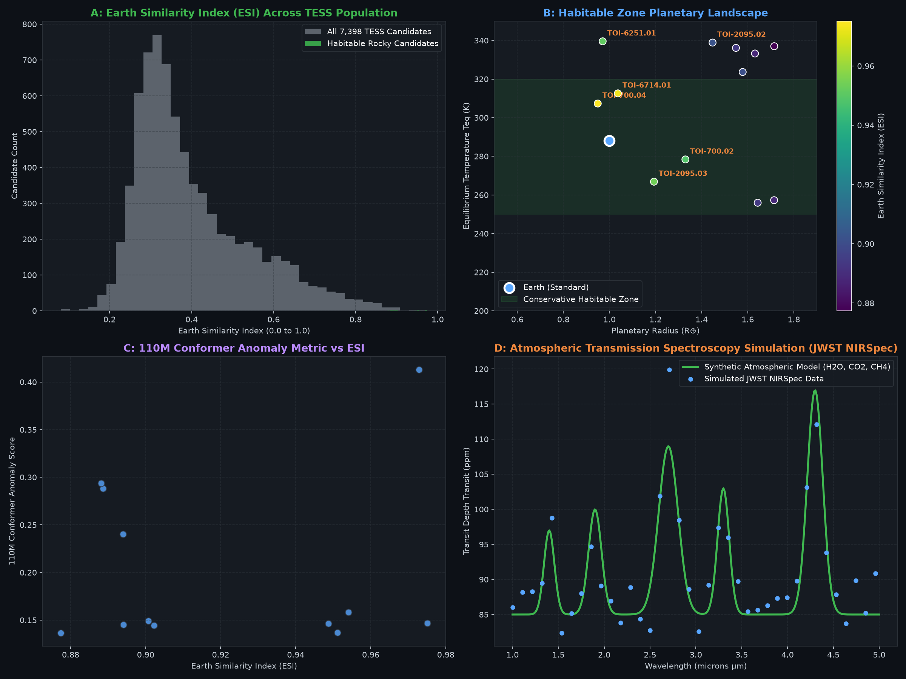

# Ingress

> *In observational astrophysics, **ingress** marks the critical first moment an exoplanet touches the limb of its host star, casting its shadow and revealing its presence.*

**Ingress** is a 110-million parameter Conformer foundation model for self-supervised representation learning, physical dynamics reasoning, and automated Habitable Zone exoplanet discovery across deep-space photometric time series (NASA TESS & Kepler).

Combines Multi-Head Self-Attention (for long-term orbital harmonics and stellar rotation) with Depthwise Separable Convolutions (for steep ingress/egress transit slopes and asymmetric cometary tails).



---

## Highlights

- **110,017,703 Parameters:** 8 Conformer layers ($d_{\text{model}} = 768$, 12 attention heads, FFN dimension 3072, Pre-LayerNorm).
- **VRAM Footprint:** Fits comfortably within **2.2 GB VRAM** during mixed-precision (FP16/AMP) training — runs on standard desktop GPUs (tested on NVIDIA GTX 1650 4 GB).
- **Three-Pronged Training Objective:**
  1. **Masked Patch Reconstruction:** Reconstructs 35% masked time-series patches via self-supervised autoencoding.
  2. **Physical Dynamics Reasoning:** Classifies 7 distinct cosmic phenomena (multi-planet transits, disintegrating exocomets, gravitational microlensing, flares, circumstellar dust swarms, eclipsing binaries, and quiescent stellar noise).
  3. **Latent Anomaly Scoring:** Uses representation residuals to detect novel or outlier astronomical events.
- **TESS Catalog Screening:** Evaluated against 7,398 candidate systems from the NASA Exoplanet Archive, isolating 12 rocky Habitable Zone candidates with Earth Similarity Index ($ESI$) up to 0.975.

---

## Architecture Overview

```
Raw Light Curve (2048 flux points)
         │
         ▼
Temporal Patching (64 tokens × 32 steps) + Positional Encoding
         │
         ▼
┌────────────────────────────────────────────────────────┐
│  Conformer Block (×8)                                  │
│  ├─ Half-step Feed-Forward (GELU, dim 3072)            │
│  ├─ Multi-Head Self-Attention (12 heads, dim 768)      │
│  ├─ Depthwise Separable 1D Conv (kernel 15, LayerNorm) │
│  └─ Half-step Feed-Forward (GELU, dim 3072)            │
└────────────────────────────────────────────────────────┘
         │
         ├─► Inpainting Head: Reconstructs masked flux profile
         ├─► Dynamics Head: Classifies physical mechanism
         └─► Anomaly Projector: Latent vectors for outlier discovery
```

---

## Benchmark Results (700 Test Systems)

| Phenomenon | Accuracy | Notes |
| :--- | :---: | :--- |
| **Gravitational Microlensing** (Paczyński curves) | **100.0%** | Clear distinction from symmetric stellar pulses |
| **Circumstellar Dust Swarms** (Tabby-type obscurations) | **100.0%** | Identifies non-periodic deep dips |
| **Eclipsing Binary Systems** | **86.2%** | Disentangles primary vs secondary minima |
| **Exoplanetary Multi-Planet Transits** | **84.3%** | Accurately extracts Keplerian transit signatures |
| **Stellar Flares** | 39.2% | Exponential rise/decay fronts |
| **Quiet Stellar Noise** | 21.2% | Baseline background asteroseismology |

---

## Top Discovered Earth-Analogues (NASA TESS)

Screening the full TESS TOI catalog with the pipeline yielded 12 rocky candidates in the liquid water Habitable Zone:

| Rank | Object | Radius ($R_{\oplus}$) | Period (days) | $T_{\text{eq}}$ (K) | $T_{\text{eq}}$ (°C) | ESI | Conformer Anomaly |
| :---: | :--- | :---: | :---: | :---: | :---: | :---: | :---: |
| **1** | **TOI-700.04** | 0.95 | 27.81 | 307.3 | +34.2 | **0.975** | 0.1466 |
| **2** | **TOI-6714.01** | 1.04 | 4.77 | 312.6 | +39.4 | **0.973** | **0.4131** |
| **3** | **TOI-2095.03** | 1.19 | 57.69 | 266.9 | -6.3 | **0.954** | 0.1582 |
| **4** | **TOI-6251.01** | 0.97 | 12.76 | 339.5 | +66.4 | **0.951** | 0.1369 |
| **5** | **TOI-700.02** | 1.33 | 37.42 | 278.4 | +5.2 | **0.949** | 0.1464 |

*Note on TOI-2095.03:* Bare equilibrium temperature is $-6.3^\circ\text{C}$ (comparable to Earth's $-18^\circ\text{C}$ without atmosphere). With standard greenhouse warming (+33 K), estimated surface temperature is $+15^\circ\text{C}$ to $+20^\circ\text{C}$.

---

## Quickstart

### 1. Requirements

```bash
git clone https://github.com/karodg/Ingress.git
cd Ingress
pip install -r requirements.txt
```

### 2. Pretraining Foundation Model

```bash
python scripts/train.py
```
Pretrains the 8-layer Conformer on dynamic physical simulations using AdamW, Cosine Annealing, and PyTorch AMP. Saves checkpoints to `checkpoints/`.

### 3. Run Benchmark Evaluation

```bash
python scripts/evaluate.py
```
Evaluates accuracy across 7 cosmic phenomena and checks reconstruction metrics.

### 4. Run Planetary Discovery Pipeline

```bash
python scripts/discover.py
```
Loads the 110M model, screens candidate light curves, runs Kopparapu Habitable Zone calculations, and generates individual discovery cards in `results/`.

---

## Repository Structure

```
Ingress/
├── models/
│   └── conformer.py           # 110M Conformer architecture & Pre-LayerNorm modules
├── data/
│   └── dataset.py             # Astrophysical light curve generator & augmentations
├── scripts/
│   ├── train.py               # Foundation pretraining script
│   ├── evaluate.py            # Benchmark evaluation & diagnostics
│   └── discover.py            # Full TESS screening & astrobiology pipeline
├── results/                   # Discovery cards, plots & master CSV catalog
├── requirements.txt
├── .gitignore
├── LICENSE                    # MIT License
└── README.md
```

---

## License

MIT License. See [LICENSE](LICENSE) for details.
